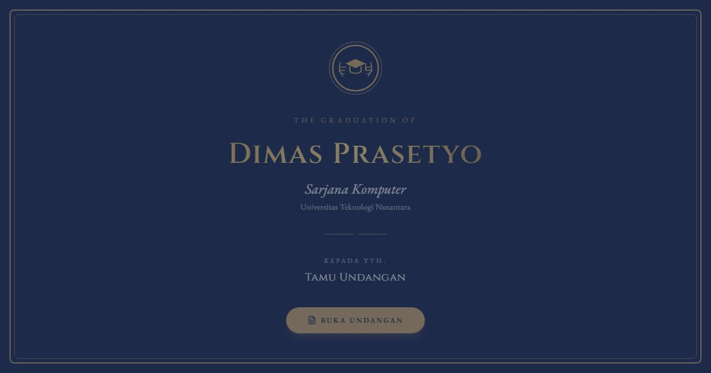

# Undangan Digital — Wisuda (Academic Program)

**Demo live:** https://undangan-wisuda-ten.vercel.app



> Undangan contoh dengan data fiktif. Formulir ucapan hanya demo dan tidak menyimpan data.

Konsep **buku program akademik** yang formal — struktur & komponennya beda dari varian lain:

- **Cover** — seal/lambang akademik (`Crest`), nama + gelar, latar navy
- **Hero** — foto toga berbingkai formal, gelar & universitas
- **Quote** — kata syukur
- **AcademicJourney** — timeline **riwayat pendidikan** (SD→S1)
- **Achievements** — kartu profil akademik (IPK, predikat, fakultas, prodi)
- **CeremonyProgram** — komponen tanda tangan: **rundown acara wisuda** berwaktu
- **EventDetails** — detail acara + add to calendar
- **CountdownTimer**, **Gallery**, **MapEmbed**, **WishesForm** (ucapan selamat), **Footer**
- **Decorations** — ornamen sudut laurel emas (halus, formal)

Tema **navy & emas**, font **Cinzel** (engraved seperti ijazah) + **EB Garamond**. Responsif terverifikasi (320/375/768px).

## Menjalankan
```bash
npm install && npm run dev
```
Semua konten di **`lib/data.js`** (objek `graduate`, `journey`, `achievements`, `program`, `event`).

---

Bagian dari koleksi 8 undangan digital di [PortalUndangan](https://portal-undangan-eta.vercel.app). Dibuat oleh [PintuWeb](https://pintuweb.com), jasa pembuatan website.
